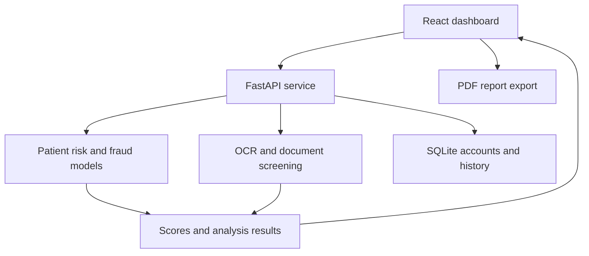

<h1 align="center">MedGuard-X</h1>
<p align="center"><strong>AI-assisted health risk and medical fraud screening</strong></p>
<p align="center">Patient insights. Document analysis. One connected workspace.</p>

<p align="center">
  <a href="https://medgaurd-x.vercel.app"><strong>Explore the demo</strong></a> &nbsp;·&nbsp;
  <a href="https://medgaurd-x.onrender.com/docs"><strong>API documentation</strong></a> &nbsp;·&nbsp;
  <a href="#quick-start"><strong>Quick start</strong></a> &nbsp;·&nbsp;
  <a href="docs/ARCHITECTURE.md"><strong>Architecture</strong></a>
</p>

<p align="center">
  
  
  
  
  
</p>

## Health intelligence, in context

<p align="center"></p>

MedGuard-X is a full-stack demonstration project that combines **XGBoost predictions**, **OCR text extraction**, and **document structure analysis**. A React dashboard brings together patient input, model scores, saved analyses, and downloadable PDF reports.

> **Project scope:** Built for research and education. Scores are screening signals, not clinical diagnoses, proof of fraud, or verification of document authenticity.

## Capabilities

| Area | What you can do | Implementation |
| --- | --- | --- |
| Health risk | Review Low, Medium, or High model predictions | XGBoost with preprocessing artifacts |
| Fraud screening | Inspect a record's predicted class and score | XGBoost classifier |
| Document analysis | Extract text and inspect medical-document signals | pdfplumber, Tesseract OCR, OpenCV |
| Analysis workspace | Review results and export PDF reports | React, Framer Motion, jsPDF |
| Account history | Save, revisit, and delete account-specific analyses | FastAPI, JWT, SQLite |
| Account management | Register, sign in, reset passwords, and manage profiles | bcrypt, SMTP, authenticated endpoints |

## How it works



Read the [architecture notes](docs/ARCHITECTURE.md) for preprocessing, document analysis, and source-file responsibilities.

## Quick start

### Prerequisites

- Python 3.11 or newer, with a version compatible with the pinned dependencies in `requirements.txt`.
- Node.js **22.12 or newer** for the Vite 8 frontend; use a supported Node LTS release.
- Tesseract OCR installed and available on your system path. On Windows, the backend also checks `C:\Program Files\Tesseract-OCR\tesseract.exe`.
- Git and npm.

### 1. Clone and configure

```bash
git clone https://github.com/HarshaAlamanda/MedGaurd-X.git
cd MedGaurd-X
python -m venv .venv
```

Activate the environment:

| Shell | Command |
| --- | --- |
| macOS / Linux | `source .venv/bin/activate` |
| Windows PowerShell | `.venv\Scripts\Activate.ps1` |
| Windows Command Prompt | `.venv\Scripts\activate.bat` |

```bash
python -m pip install -r requirements.txt
```

Copy `.env.example` to `.env` (`cp .env.example .env` on macOS/Linux; `Copy-Item .env.example .env` in PowerShell). Replace the placeholder secrets before use.

### 2. Run the backend

From the repository root:

```bash
python -m uvicorn api:app --host 127.0.0.1 --port 8001 --reload
```

Open [local API documentation](http://localhost:8001/docs). Keep this terminal running.

### 3. Run the frontend

In a second terminal:

```bash
cd frontend
npm ci
npm run dev
```

Open **http://localhost:5173**. Use `localhost`: the current API client chooses its local proxy by hostname. The Vite proxy forwards supported API routes to port `8001`.

### Environment configuration

| Variable | Purpose |
| --- | --- |
| `MEDGUARD_SECRET` | JWT signing secret; replace the development value |
| `FRONTEND_URL` | Frontend origin and password-reset link base |
| `SMTP_HOST`, `SMTP_PORT` | Outgoing mail server configuration |
| `SMTP_USER`, `SMTP_PASS` | Credentials used for password-reset email |
| `ADMIN_KEY` | Shared key for the administrative CSV export endpoint |

Keep `.env`, credentials, uploaded documents, and local database files out of commits. Use synthetic records when trying the demo.

## Repository guide

| Path | Responsibility |
| --- | --- |
| `api.py` | API routes, authentication, model loading, and OCR orchestration |
| `database.py` | SQLite persistence for users, analyses, and tokens |
| `medical_cnn.py` | OpenCV features and optional MobileNetV2 support |
| `train_health.py` | Health-model training and evaluation script |
| `generate_dataset.py` | Synthetic dataset generation |
| `*_model.joblib`, `*_scaler.joblib`, `*_imputer.joblib` | Serialized inference artifacts |
| `health_features.json`, `fraud_features.json` | Ordered model input schemas |
| `frontend/src/` | Pages, components, API client, and PDF export |
| `docs/ARCHITECTURE.md` | System design and model limitations |
| `CHANGELOG.md` | Project change history |

## API at a glance

| Area | Routes |
| --- | --- |
| Authentication | `/auth/register`, `/auth/login`, `/auth/forgot-password`, `/auth/reset-password` |
| Predictions | `/predict/health`, `/predict/fraud` |
| Documents | `/analyze/document` |
| History | `/analyses`, `/analyses/{analysis_id}` |
| Profile | `/auth/profile`, `/auth/change-password`, `/auth/account` |
| Administration | `/admin/export-users` |

Use the [interactive API reference](https://medgaurd-x.onrender.com/docs) for HTTP methods, request schemas, and authentication requirements.

## Deployment

### From source to deployment

<p align="center"></p>
<p align="center"><sub>Illustrative animation, not a deployment-status indicator.</sub></p>

| Component | Hosting configuration | Application link |
| --- | --- | --- |
| Frontend | Vercel; project root `frontend`, build `npm run build`, output `dist` | [Open dashboard](https://medgaurd-x.vercel.app) |
| Backend | Render; service configuration in `render.yaml` | [Open API reference](https://medgaurd-x.onrender.com/docs) |

Automatic deployment behavior depends on the connected hosting account's settings. The frontend currently points non-local requests to the Render URL in `frontend/src/api/axios.js`; update that file when changing API hosts. Configure `FRONTEND_URL` and secrets in the backend hosting environment.

SQLite writes to `medguard.db` beside `database.py`. A production deployment needs an explicit persistence strategy; an ephemeral filesystem can lose saved users and analyses on replacement or redeployment.

## Model scope and limitations

- The checked-in feature schemas each list **17 inputs**, including encoded and derived fields—not 17 separate patient vitals.
- `train_health.py` constructs risk labels using rules. Evaluation against those labels measures agreement with those rules, not clinical validation.
- `generate_dataset.py` produces synthetic data. This repository does not establish real-world clinical performance or calibrated fraud probabilities.
- OCR quality varies with resolution, layout, language, and scan quality. Document structure and keywords cannot prove authenticity.
- MobileNetV2 is optional. The default requirements omit PyTorch and torchvision, so document scoring uses the OpenCV fallback unless those dependencies are installed.
- The repository includes fraud inference artifacts, but no `train_fraud.py`; end-to-end fraud-model retraining is not documented here.

## Development and contributions

See [CONTRIBUTING.md](CONTRIBUTING.md) for setup, validation, and pull-request guidance. Use the issue templates for reproducible bugs and feature proposals.

```bash
cd frontend
npm run lint
npm run build
```

These commands check frontend linting and production compilation. `test_app.py` is a Streamlit smoke demo, not an automated API test suite.

## Animation Credits

- [Heart Monitor Flat Icon GIF Animation.gif](https://commons.wikimedia.org/wiki/File:Heart_Monitor_Flat_Icon_GIF_Animation.gif) by [Videoplasty.com](https://videoplasty.com), licensed under [CC BY-SA 4.0](https://creativecommons.org/licenses/by-sa/4.0/). Original GIF embedded unchanged.
- [WP25 Rocket - blue.gif](https://commons.wikimedia.org/wiki/File:WP25_Rocket_-_blue.gif) by Wikimedia Foundation staff and contractors, licensed under [CC BY 4.0](https://creativecommons.org/licenses/by/4.0/). Original GIF embedded unchanged; displayed at a smaller size.

---

## Author

**Harsha Vardhan Alamanda** · [GitHub](https://github.com/HarshaAlamanda) · [Email](mailto:aharsha1587@gmail.com)

<p align="center"><sub>Built with FastAPI · React · XGBoost · Tesseract OCR · OpenCV</sub></p>
