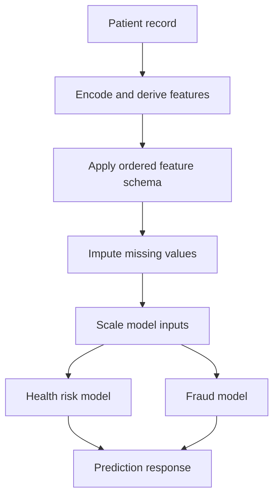
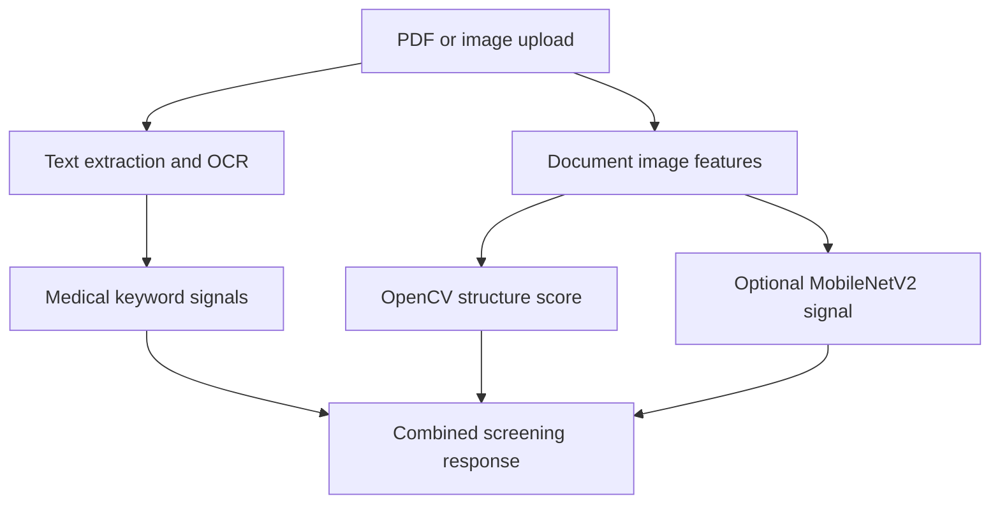

# Architecture

[Back to README](../README.md)

## Application boundaries

The React application presents forms, document uploads, analysis history, and reports. FastAPI owns authentication, predictions, document processing, and persistence. PDF reports are generated in the browser using jsPDF.

This is a conceptual flow: each prediction path uses its own feature list, imputer, scaler, and model. Preserve artifact compatibility and feature order when retraining. Both checked-in feature JSON files list 17 fields.

## Document analysis

`api.py` extracts PDF text with pdfplumber and uses Tesseract for OCR. `medical_cnn.py` measures layout features such as light backgrounds, edges, text regions, and table lines. If PyTorch and torchvision are available, a pretrained MobileNetV2 model adds a secondary signal. The default dependencies use the OpenCV-only path.

The result describes resemblance to medical documents. It does not establish who issued a document or whether its contents are authentic.

## Identity and storage

JWTs represent authenticated sessions, bcrypt hashes passwords, and SMTP delivers reset links. SQLite stores users, analyses, and token data in `medguard.db`. History and account routes enforce authentication; consult the route implementation for the requirements of each endpoint. Administrative CSV export uses a separate shared key.

## Frontend routing

`frontend/src/App.jsx` defines application routes. `frontend/src/api/axios.js` sends local requests through Vite and non-local requests to the configured Render host. `frontend/vercel.json` supplies SPA routing. PDF export lives in `frontend/src/utils/exportPdf.js`.

## Training and evaluation

`train_health.py` derives Low, Medium, and High labels from thresholds and condition text, performs preprocessing, and trains an XGBoost classifier. Reported evaluation measures agreement with derived labels. It is not evidence of clinical effectiveness. The synthetic generator and serialized artifacts support experimentation; dataset provenance and independent validation need further documentation.

## Operational considerations

- Run the backend from the repository root so relative artifact paths resolve.
- Install the Tesseract system executable as well as the Python wrapper.
- Keep model libraries compatible with the serialized artifacts.
- Set unique JWT and administrative secrets before deploying.
- Plan persistent storage before relying on account history.
- Review handling of uploaded documents and personal data before any real-world use.
